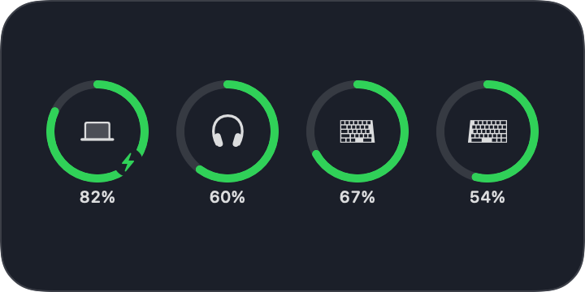
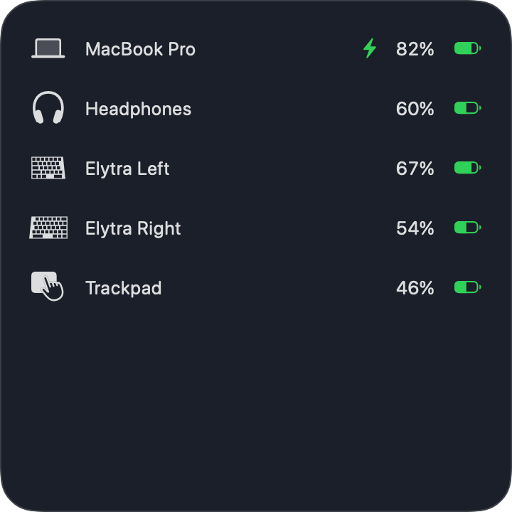

# Batteries++

A native macOS battery app with desktop widgets, device management, a menu bar interface, and a command-line tool for registering custom devices.

## Widget previews

SwiftUI-rendered previews with sample device data. Desktop backgrounds and tinting vary with the macOS appearance and widget settings.

### Circular layout



### List layout



## Build and run

Requires macOS 14 or later and a full Xcode installation.

```bash
./build.sh
open 'build/Build/Products/Release/Batteries++.app'
```

Right-click the desktop, choose **Edit Widgets**, search for **Batteries++**, and add a small, medium, or large widget.

## Register and update devices

Choose **Register Device** in the app to configure a name, battery level, category, and icon. Imported images are converted to PNG and stored in the app's data directory.

The command-line tool is located at `Contents/MacOS/batteryctl` inside the app bundle.

```bash
APP='build/Build/Products/Release/Batteries++.app'
"$APP/Contents/MacOS/batteryctl" register --id split-left --name 'Left keyboard' --level 75 --icon /absolute/path/left.png
"$APP/Contents/MacOS/batteryctl" update --id split-left --level 62 --charging true
"$APP/Contents/MacOS/batteryctl" list
"$APP/Contents/MacOS/batteryctl" remove --id split-left
```

Use `--symbol keyboard.fill` for an SF Symbol. Set `--system-sync false` to disable publishing a device to the system battery list. Registering an existing ID updates its configuration.

## Elytra icons

Select an Elytra icon in the device editor, or use `--symbol elytra.left` and `--symbol elytra.right`.

The left and right icons are template PDF assets in `App/Resources/Assets.xcassets/ElytraLeft.imageset/` and `ElytraRight.imageset/`. Their geometry follows the Elytra plate design. The keyboard silhouette is filled and the keys are transparent cutouts. Both icons share the system's foreground coloring and adapt to light, dark, and widget rendering modes.

## Battery scripts

Enable **Read Battery Level with a Script** in the device editor, enter a command and an update interval, and choose **Test Now**. After saving, the app runs the command immediately and repeats it while the app is running. Intervals range from 15 to 86400 seconds, with a default of 60 seconds. A device's script never overlaps with its previous invocation.

Scripts run as the current user with `/bin/zsh -c`, with the user's home directory as the working directory. Use an executable path or an interpreter command such as `/usr/bin/python3 /absolute/path/battery.py`. `BATTERIES_DEVICE_ID` contains the device ID. `PATH` includes common Homebrew and system locations. Standard input is closed.

Standard output accepts a battery percentage or a JSON object.

```text
75
```

```json
{"level": 75, "charging": false}
```

`level` must be an integer from 0 to 100. Omitting `charging` preserves the previous charging state. Send logs to standard error and exit with status 0 on success.

A disconnected device can return this payload without a battery level.

```json
{"connected": false}
```

Each invocation has a 10-second timeout and a combined stdout/stderr limit of 64 KB. A timeout terminates the process group. A disconnected device or failed reading hides the device from battery displays and system publishing. Its registration and last saved percentage remain available in the management interface, where errors are shown. The next successful reading restores visibility. Script-backed devices wait for their first successful reading before appearing. Polling requires the main app to remain running.

```bash
APP="$HOME/Applications/Batteries++.app"
"$APP/Contents/MacOS/batteryctl" register --id split-left --name 'Left keyboard' \
  --symbol elytra.left --script '/usr/bin/python3 /absolute/path/left-battery.py' --interval 60
"$APP/Contents/MacOS/batteryctl" update --id split-left --script ''
```

Hardware collectors can also call `batteryctl update` to publish readings.

## System integration

- Reads existing system power sources through IOKit, including the Mac's battery and accessories that report battery levels.
- Publishes custom accessories through private IOKit SPI while the app is running. Quitting releases the published power sources and preserves device registrations.
- Supports custom images and SF Symbols in Batteries++ widgets and the menu bar. Apple's battery widget selects icons using its own device-category rules.
- Shows multipart batteries as separate system entries, with labels for left earbuds, right earbuds, and charging cases.
- Uses the private `preferredBackgroundStyle(.blur)` API used by Apple's Batteries widget to request a glass background, with support for full-color, monochrome, and accented rendering.
- Requests widget timeline updates every minute. WidgetKit controls the actual refresh schedule. Device registration and updates also request a timeline reload.

## Localization

English source keys and Simplified Chinese translations are stored in `i18n/Localizable.xcstrings`. The app, widget, and bundled CLI use these resources through `Shared/L10n.swift`. Add translations in the catalog to support additional languages.

## Signing and local data

`build.sh` applies ad-hoc signatures. Device settings and imported icons are stored in `~/Library/Application Support/BatteriesPlus/`. Writes use a file lock and atomic replacement.

The widget uses a read-only sandbox exception for that directory. This configuration supports local builds. See `Configuration/Widget.entitlements`. App Store distribution would require an App Group configured for a developer team.

IOKit publishing and WidgetKit background preferences use private SPI and require verification after system upgrades. The build prepares a local WidgetKit compatibility module from the active Xcode SDK, adding declarations for the system's existing background preference implementation. Generated files are stored in `build/WidgetKitCompatibility/`. A developer account is not required for local builds.

## License

The project's code and original assets are dual-licensed under either the [MIT License](LICENSE-MIT) or the [Apache License 2.0](LICENSE-APACHE), at your option.

SPDX license expression: `MIT OR Apache-2.0`.

Copyright (c) 2026 Batteries++ contributors.

Apple frameworks, SDK components, and SF Symbols remain subject to Apple's own terms.
